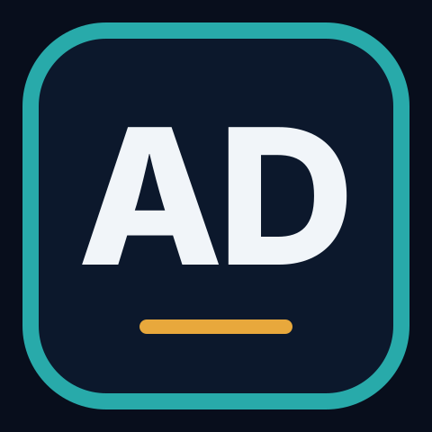

<p align="left">
  
</p>

# AgencyDesk Skills — Insurance (Free Sample)

[](https://skills.sh/LandrewConsulting/agencydesk-skills)
[](https://landmconsultinginc.com/ai-skills/)
[](https://agensi.io/skills/coi-contract-check)
[](./LICENSE)

Clerical AI agent skills by **AgencyDesk Skills** (L&M Consulting Inc.). This repository hosts a single free sample from the 11-skill AgencyDesk Insurance pack: **`coi-contract-check` (COI Contract Check)**.

Skills follow the open [Agent Skills](https://agentskills.io/) specification.

## Available Skill

### `coi-contract-check` — COI Contract Check

Compares a certificate of insurance (ACORD 25 or equivalent) against contract, lease, or agreement insurance requirements and outputs a structured clerical review draft:

- **Document identification:** checks named insured, certificate holder, effective dates, and contract parties, flagging mismatches up front.
- **Side-by-side comparison table:** extracts limits, deductibles, form numbers, additional insured references, waiver of subrogation, and primary/non-contributory wording with citations on both sides.
- **Defined clerical statuses:** `Documented match`, `Documented difference`, `Partial`, `Verification required`, `Not found in supplied documents`, and `Unclear — unreadable or ambiguous`.
- **Flagged for licensed review & neutral questions:** highlights discrepancies and endorsement-dependent items and drafts up to five neutral fact-gathering questions for a licensed agent.

## Installation

Install with the [skills CLI](https://skills.sh/docs/cli):

```bash
npx skills add LandrewConsulting/agencydesk-skills
```

Or target a specific agent (for example Claude Code or Cursor):

```bash
npx skills add LandrewConsulting/agencydesk-skills --skill coi-contract-check -a claude-code
```

> [!TIP]
> **Get the full Insurance pack:** This repo contains one free sample skill (**COI Contract Check**). Visit the [AgencyDesk Skills Store](https://landmconsultinginc.com/ai-skills/) for the complete 11-skill Insurance bundle ($99 one-time for one agency) as well as more skills for small businesses and industries.

## Example Prompt

```text
Compare this ACORD 25 certificate of insurance against Section 4 of the attached contract. List documented matches, documented differences, and items requiring endorsement verification.
```

## What This Skill Does NOT Do (Clerical Only)

This skill is strictly a clerical document-comparison tool for internal agency use under licensed-producer supervision:

- Does **not** state or imply what is or is not covered, whether a claim would be paid, or whether coverage is adequate.
- Does **not** declare a certificate "compliant," "acceptable," "sufficient," or "meeting the contract."
- Does **not** interpret policy forms or endorsements (`Additional insured`, `Waiver of subrogation`, and `Primary and non-contributory` references are always marked `Verification required` for underlying endorsement confirmation).
- Does **not** recommend buying, dropping, changing, or binding coverage, and must **not** be used as a consumer-facing chatbot.
- Every output begins with `Internal use only — Draft for review by a licensed agent` and requires verification against source documents by a licensed insurance agent before any external use.

## Supported Agents

Compatible with AI agents that support the [Agent Skills](https://agentskills.io/) specification, including **Claude Code**, **Cursor**, **Codex**, **OpenCode**, **Windsurf**, **Cline**, **GitHub Copilot**, **Gemini CLI**, **Roo Code**, and [70+ others](https://github.com/vercel-labs/skills/blob/main/docs/agents.md).

## Skill Structure

```text
skills.sh.json
assets/
  agencydesk-mark.svg
skills/
  coi-contract-check/
    SKILL.md
    references/
      glossary.md
```

## Links

- **AgencyDesk Skills Store (full 11-skill Insurance pack & more):** [https://landmconsultinginc.com/ai-skills/](https://landmconsultinginc.com/ai-skills/)
- **Agensi Listing (`COI Contract Check`):** [https://agensi.io/skills/coi-contract-check](https://agensi.io/skills/coi-contract-check)

## License

This repository is licensed under the [MIT License](./LICENSE). Skills are provided "as is" without warranty; outputs are clerical drafts only and require review by a licensed insurance agent before reliance or external use.

---

### More AgencyDesk Skills

Looking for the full 11-skill Insurance pack or more skills for small businesses and industries? Explore all packs at **[landmconsultinginc.com/ai-skills](https://landmconsultinginc.com/ai-skills/)**.

Published by L&M Consulting.
